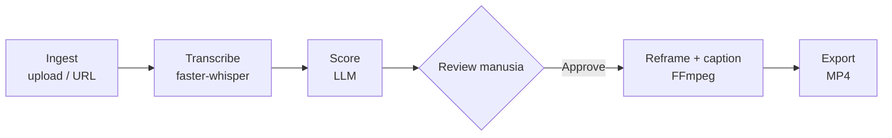
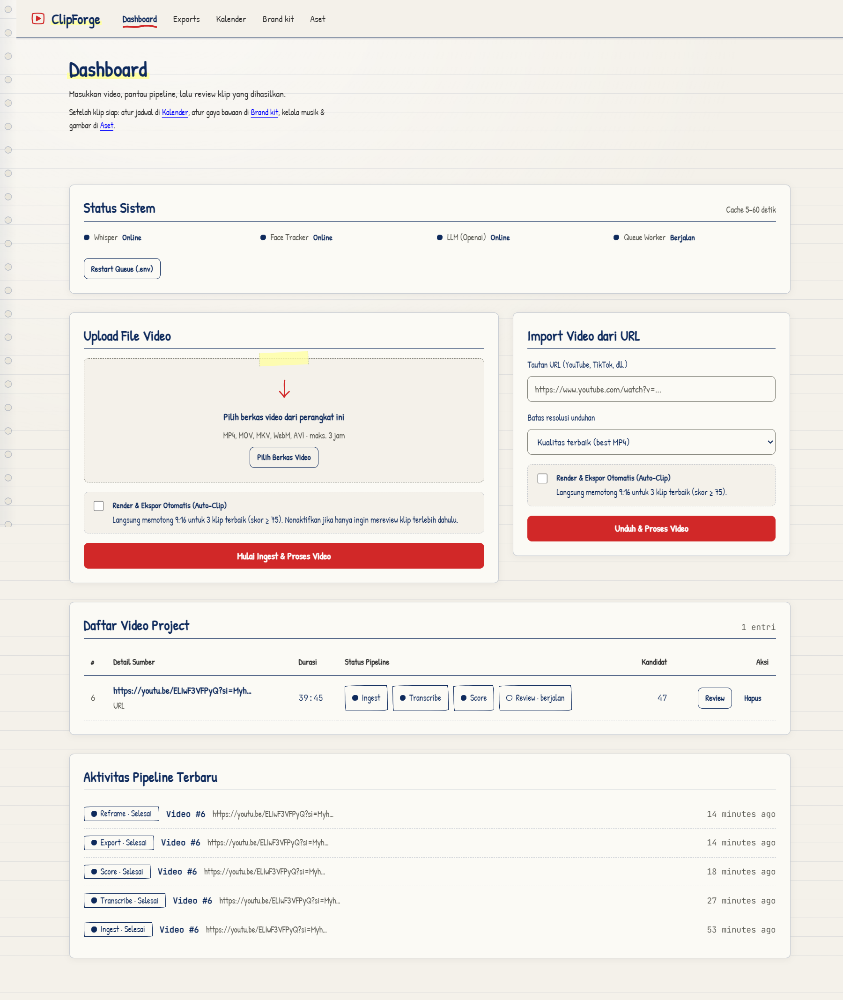
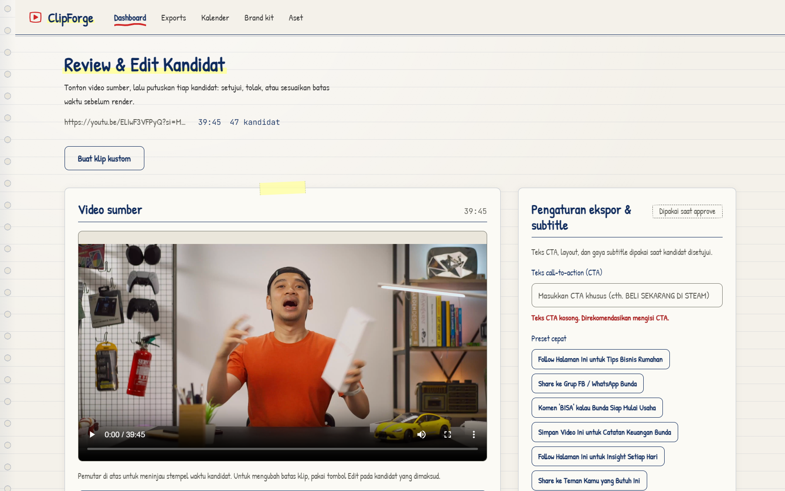
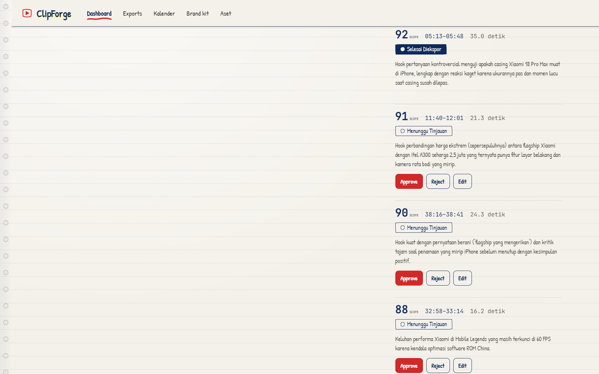
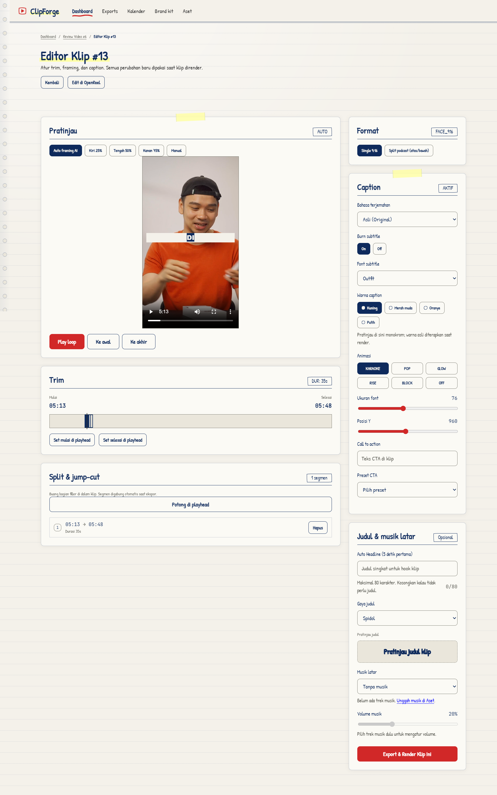
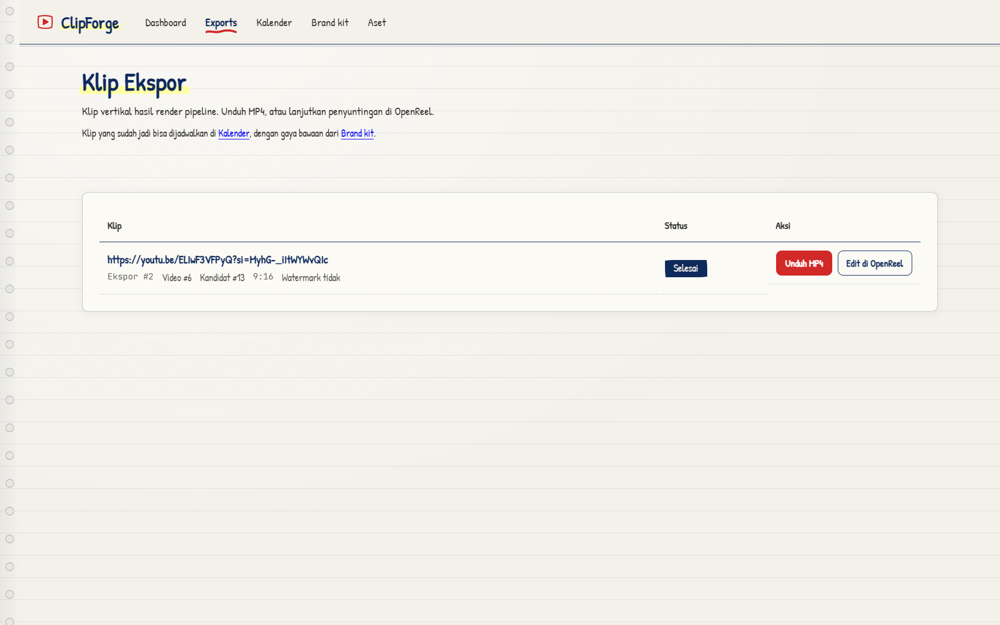
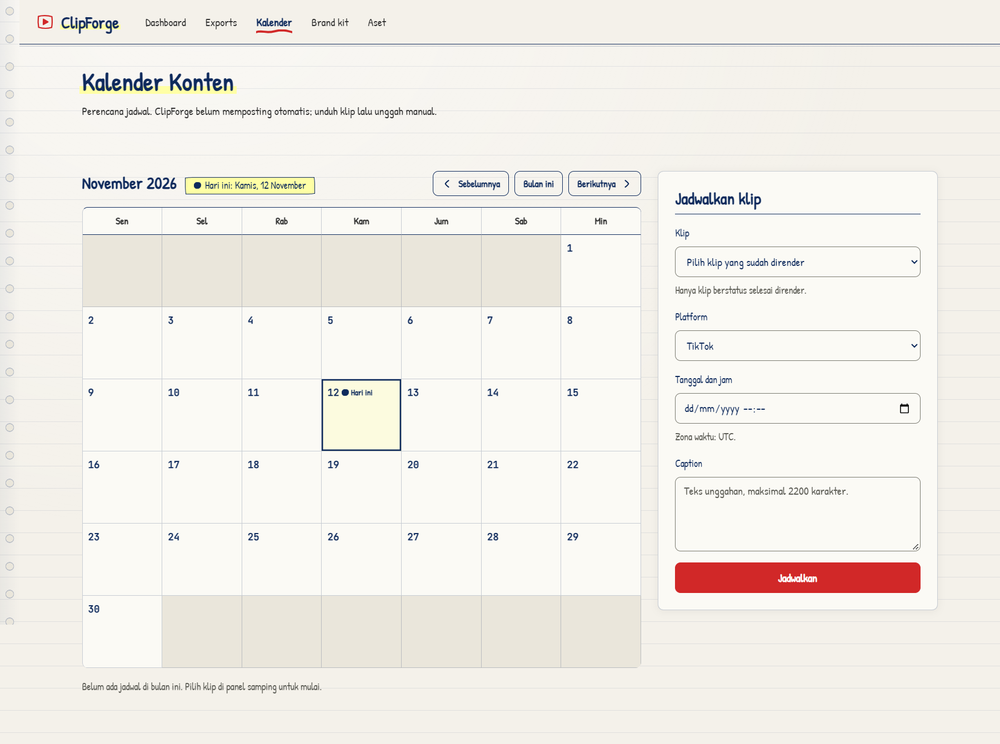
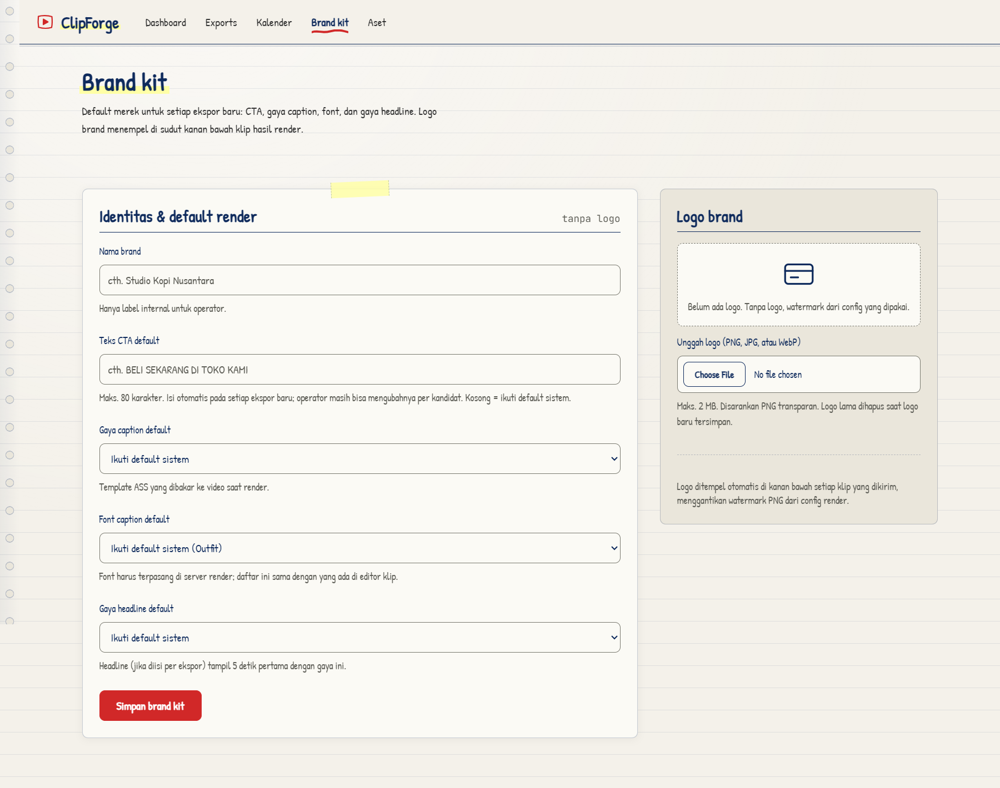
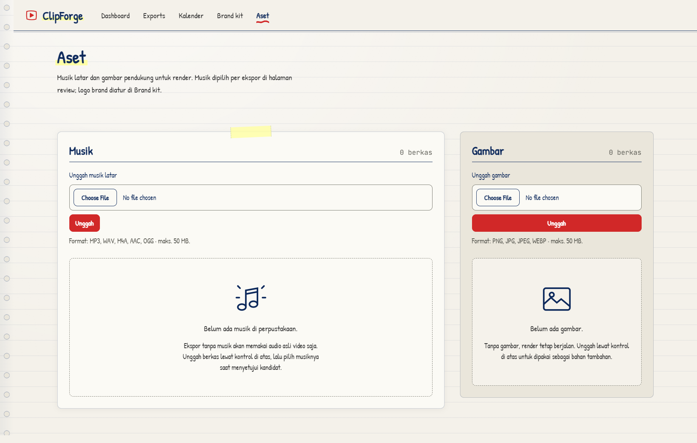

# ClipForge AI

Pipeline self-hosted yang mengubah video panjang (podcast, webinar, livestream, UGC) menjadi klip vertikal 9:16 berkaption, siap untuk Reels, Shorts, dan TikTok. Konsepnya mirip OpusClip atau Vizard, tetapi berjalan di mesin sendiri: data tidak keluar, tanpa biaya langganan.

Stack: Laravel 13, Livewire 4, SQLite, queue database, FFmpeg, faster-whisper, LLM lewat endpoint OpenAI-compatible.

---

## Alur pipeline



| Tahap | Tugas | Teknologi |
|---|---|---|
| Ingest | Validasi file atau URL (cek SSRF dan magic bytes), simpan sumber, baca durasi | Laravel, `yt-dlp`, `ffprobe` |
| Transcribe | Transkrip dengan timestamp per kata | `faster-whisper` (service Python, port 9000) |
| Score | Cari momen paling menarik dan beri skor hook per kandidat, per batch 40 segmen | LLM OpenAI-compatible (default 9router, port 20128) |
| Reframe | Crop ke 9:16 mengikuti wajah, bakar caption ASS, gabung segmen, mix musik, tempel logo | Service face tracker (`services/reframe`, port 9100), `ffmpeg` |
| Export | Simpan MP4 final dan siapkan unduhan | `ffmpeg`, Livewire |

Setiap tahap adalah job queue terpisah dengan timeout sendiri (`AUTOCLIP_TIMEOUT_*`). Status tiap tahap terlihat di dashboard.

---

## Halaman

Navigasi atas: **Dashboard, Exports, Kalender, Brand kit, Aset**. Halaman Review dan Editor Klip dibuka dari Dashboard.

### 1. Dashboard `/`



- **Status Sistem**: cek langsung Whisper, Face Tracker, LLM, dan Queue Worker (cache 5 sampai 60 detik). Tombol *Restart Queue* menjalankan `queue:restart` supaya worker memuat `.env` terbaru.
- **Upload File Video**: MP4, MOV, MKV, WebM, AVI, maksimal 3 jam.
- **Import Video dari URL**: YouTube, TikTok, dan lainnya lewat `yt-dlp`, dengan batas resolusi unduhan.
- **Render & Ekspor Otomatis (Auto-Clip)**: kalau dicentang, 3 klip terbaik (skor 75 atau lebih) langsung dirender 9:16. Kosongkan kalau mau review dulu.
- **Daftar Video Project**: durasi, status tiap tahap (Ingest, Transcribe, Score, Review), jumlah kandidat, tombol *Review* dan *Hapus*.
- **Aktivitas Pipeline Terbaru**: log job terakhir per video.

### 2. Review video `/videos/{id}/review`



- Pemutar video sumber untuk meninjau timestamp kandidat.
- **Pengaturan ekspor & subtitle** (dipakai saat Approve): teks CTA beserta preset cepat, layout (`single`, `split_podcast`, `split_gaming`), dan gaya subtitle.
- **Buat klip kustom**: bikin kandidat manual di luar saran LLM.



Tiap kandidat menampilkan skor hook, rentang waktu, durasi, alasan dari LLM, dan statusnya. Aksi: **Approve** (memicu render), **Reject**, **Edit** (buka Editor Klip). Approve bersifat atomik, jadi klik ganda tidak membuat dua render.

### 3. Editor Klip `/candidates/{id}/edit`



- **Pratinjau** vertikal dengan mode framing: Auto framing AI, Kiri 25%, Tengah 50%, Kanan 75%, Manual. Ada *Play loop*.
- **Trim**: ubah awal dan akhir klip, atau set dari posisi playhead.
- **Split & jump-cut**: buang bagian filler di tengah klip; segmen disambung otomatis saat render.
- **Format**: Single 9:16 atau Split podcast (atas/bawah).
- **Caption**: bahasa terjemahan, burn subtitle on/off, font, warna, animasi (Karaoke, Pop, Glow, Rise, Block, Off), ukuran font, posisi Y, teks CTA.
- **Judul & musik latar**: Auto Headline (maks. 80 karakter, tampil 5 detik pertama, beberapa gaya), pilih musik dari Aset, atur volume.
- **Export & Render Klip Ini**: kirim ke render.

### 4. Exports `/exports`



Daftar klip hasil render beserta status. *Unduh MP4* mengambil file final; *Edit di OpenReel* membuka editor video di `/openreel`.

### 5. Kalender `/calendar`



Perencana jadwal konten bulanan. Pilih klip yang sudah selesai dirender, platform, tanggal-jam (zona waktu UTC), dan caption (maks. 2200 karakter). **ClipForge tidak memposting otomatis**: unduh klip lalu unggah manual.

### 6. Brand kit `/brand`



Default merek yang diisi otomatis pada setiap ekspor baru: nama brand, CTA default, gaya caption, font, gaya headline. Logo (PNG, JPG, WebP, maks. 2 MB) ditempel di sudut kanan bawah klip dan menggantikan watermark dari config.

### 7. Aset `/assets`



Perpustakaan musik latar (MP3, WAV, M4A, AAC, OGG, maks. 50 MB) dan gambar pendukung (PNG, JPG, JPEG, WebP, maks. 50 MB). Musik dipilih per klip di Editor Klip.

---

## Prasyarat

- PHP 8.3 atau lebih baru dan Composer
- Node.js (untuk Vite)
- FFmpeg dan FFprobe di `PATH`
- `yt-dlp` di `PATH` (untuk import URL). Untuk YouTube, tambahkan `--js-runtimes node` dan `--remote-components ejs:github` di config `yt-dlp` agar challenge JS terselesaikan.
- Python 3 untuk service whisper dan face tracker
- Endpoint LLM OpenAI-compatible, misalnya 9router di `http://localhost:20128/v1`

## Instalasi

```bash
composer install
npm install
cp .env.example .env
php artisan key:generate
php artisan migrate
```

Isi `.env`: bagian terpenting adalah LLM.

```env
AUTOCLIP_LLM_DRIVER=openai
AUTOCLIP_LLM_ENDPOINT=http://localhost:20128/v1
AUTOCLIP_LLM_API_KEY=isi_api_key_anda
AUTOCLIP_LLM_MODEL=nama-model-anda

AUTOCLIP_WHISPER_ENDPOINT=http://127.0.0.1:9000
AUTOCLIP_WHISPER_MODEL=large-v3-turbo
AUTOCLIP_FACE_ENDPOINT=http://127.0.0.1:9100
```

Semua variabel lain ada di `.env.example`. Jangan commit `.env`.

### Service Python

```bash
cd services/whisper
python -m venv .venv
.venv\Scripts\activate          # Windows; Linux/macOS: source .venv/bin/activate
pip install -r requirements.txt
```

Face tracker ada di `services/reframe` (setup sama, lihat README di foldernya).

## Menjalankan

Jalankan tiap proses di terminal terpisah.

```bash
php artisan serve                       # web, http://127.0.0.1:8000
php artisan queue:work --tries=3        # worker pipeline
```

```bash
cd services/whisper
# CPU (default, int8):
python app.py
# GPU NVIDIA (jauh lebih cepat, lihat bagian berikut):
set WHISPER_DEVICE=cuda
set WHISPER_COMPUTE_TYPE=float16
set WHISPER_MODEL=large-v3-turbo
python app.py                           # port 9000
```

```bash
cd services/reframe
python app.py                           # port 9100
```

Dashboard menampilkan status keempat komponen di panel *Status Sistem*.

### Whisper di GPU

Di CPU, transkripsi video 40 menit (`large-v3-turbo`, int8, 4 thread) belum menghasilkan apa pun setelah 22 menit 39 detik dan job gagal. Di RTX 3050 6 GB dengan `float16`, video yang sama selesai dalam 2 menit 34 detik (835 segmen, bahasa Indonesia).

Syarat GPU: pasang paket CUDA ke venv whisper.

```bash
pip install nvidia-cublas-cu12 "nvidia-cudnn-cu12==9.*"
```

`services/whisper/app.py` mendaftarkan folder DLL paket itu sendiri di Windows, jadi tidak perlu mengubah `PATH`. Variabel `WHISPER_*` dibaca dari environment proses, bukan dari `.env` Laravel.

## Keamanan dan operasi

- **Gate operator**: isi `AUTOCLIP_BASIC_USER` dan `AUTOCLIP_BASIC_PASS` untuk mewajibkan HTTP Basic Auth di grup route web dan API. Kosong berarti tanpa auth; pakai hanya di mesin lokal.
- **TLS**: verifikasi sertifikat ke endpoint LLM aktif. Set `AUTOCLIP_LLM_INSECURE_TLS=true` hanya jika CA Windows bermasalah (cURL error 60).
- **Prune**: `php artisan autoclip:prune` menampilkan video `failed` yang lebih tua dari `AUTOCLIP_RETENTION_DAYS` (default 30) tanpa menghapus; tambahkan `--force` untuk benar-benar menghapus. Tidak dijadwalkan otomatis.
- **API**: `POST /api/videos`, `POST /api/videos/url`, `POST /api/candidates/{id}/approve|reject`, `GET /api/exports/{id}/download`, dibatasi 60 request per menit.

## Pengujian

```bash
php artisan test
```

Suite memakai fake untuk Whisper, LLM, dan FFmpeg, jadi tidak butuh service eksternal. Hasil terakhir: 182 test, 179 lulus. Tiga test `OpenReelTest` gagal karena aset `resources/openreel/` sedang tidak ada di working tree.

## Struktur singkat

```
app/Livewire/            Dashboard, ReviewVideo, ClipEditor, Exports, Calendar, BrandKitPage, AssetLibrary
app/Jobs/                IngestUrlJob, TranscribeJob, ScoreHighlightsJob, ReframeJob, ExportDeliverJob
app/Services/            Whisper, Scoring (LLM), Reframe (FFmpeg builder, caption ASS, musik), ClipReviewService
services/whisper/        faster-whisper HTTP service
services/reframe/        face tracking HTTP service
public/css/clipforge.css tema sketch-note
docs/screenshots/        gambar untuk README ini
```
